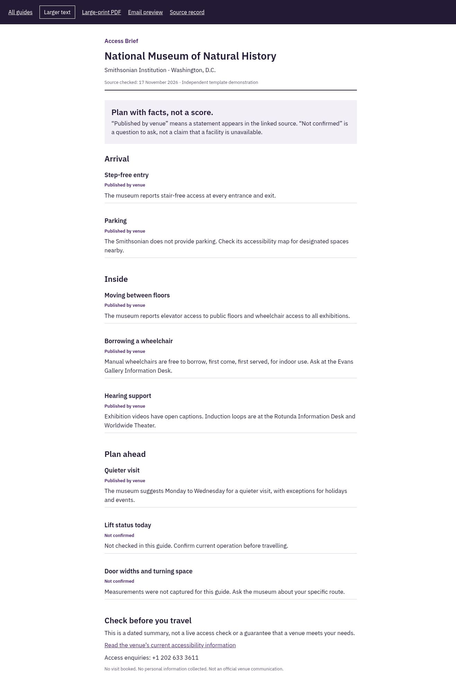

# Access Brief

**A venue access guide should help someone decide for themselves, not reduce their needs to a green tick.**

One sourced record produces three purpose-built Hyper Elements outputs:

- **Web guide:** all access facts, known/unknown distinction, source context, adjustable reading size and semantic headings.
- **Pre-visit email:** arrival essentials and questions still worth asking, with plain-text alternative.
- **Large-print PDF:** a reading copy with explicit, bounded pagination. HTML remains the primary format.



## The useful constraint

`published` does not mean inspected, certified or guaranteed. It means the linked venue source states the fact. `unknown` is a question to confirm, not a negative claim about the venue. Published statements cannot render without a venue, HTTPS source and valid review date.

The included example uses real statements from the [Smithsonian National Museum of Natural History](https://naturalhistory.si.edu/visit/accessibility), checked 17 November 2026. Current lift operation and route dimensions were not established, and remain explicitly unconfirmed. The second record is entirely blank. Neither is presented as a live or official guide.

## Run

Node 22+ is recommended.

```sh
npm ci
npm run build
npm run typecheck
npm test
npm run dev -- --port 4173
```

Open `http://localhost:4173`. Built files are in `dist/`.

To use a different record:

```sh
npm run build -- data/your-guide.json
```

The named output folder is generated; update `public/index.html` if you want it listed in the navigation. Edit a JSON record, not three different templates. No server account, network fetch or API key is required to render the bundled example.

## Hyper Elements implementation

`src/template.tsx` uses real `Page`, `Email` and `Document` roots, with shared `defineTheme`, typography, source footer and evidence labels. The output structures differ deliberately: comprehensive HTML, concise email and explicitly paginated reading copy. `src/build.tsx` renders HTML and plain text with `render`, generates PDF with `renderPdf`, runs `validate`, and creates modeled email-client previews.

There is deliberately **no image-based guide**. Text inside a social image cannot be resized or navigated as text, which undermines this template’s purpose.

## Design and evidence

[Design research and sources](docs/RESEARCH.md). The palette is functional: dark plum `#231A35` for text, purple `#4D286C` for links and labels, muted `#645A70`, white reading surface and yellow keyboard focus. Meaning is never conveyed by color alone. IBM Plex Sans is bundled through its OFL-licensed package. No icons, fabricated reviews, access scores, imagery or motion.

## Verification and limits

- Build and TypeScript pass; 19 model, contrast and render tests pass.
- Desktop and 390px iframe layout visually reviewed.
- Larger-text toggle and return to standard text verified in the browser. Skip link receives first Tab focus, becomes visible, and Enter transfers focus to the main guide.
- Actual sample PDF and a long-input PDF were rendered and visually inspected. Two facts maximum per page and a separate source-address page avoid relying on automatic page breaks. Essential PDF text is at least 18pt; section headings are 17.25pt.
- `npm run qa:pdf` creates `/tmp/access-brief-boundary.pdf` with synthetic test-only text, twelve facts and long fields. This is a focused stress fixture, not an exhaustive proof for every possible input. Words longer than 24 characters are rejected with a clear error because the PDF renderer can silently overflow unbroken strings. The actual source URL is line-wrapped separately.
- Email client diagnostics run for Gmail, Apple Mail and Outlook. These are modeled compatibility checks, not real sends to mailboxes.
- No user research with disabled visitors has been conducted. No full WCAG audit or screen-reader certification is claimed.
- PDF is **not tagged/PDF-UA-certified**. It is an optional large-print reading copy; HTML is primary.
- This is a static dated demonstration. Before using a guide for travel, check the venue’s current information and ask about individual requirements.

## License

Code: MIT. Factual descriptions are concise paraphrases, with linked attribution. IBM Plex font license: `docs/FONT-LICENSE.txt`.
